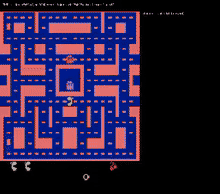
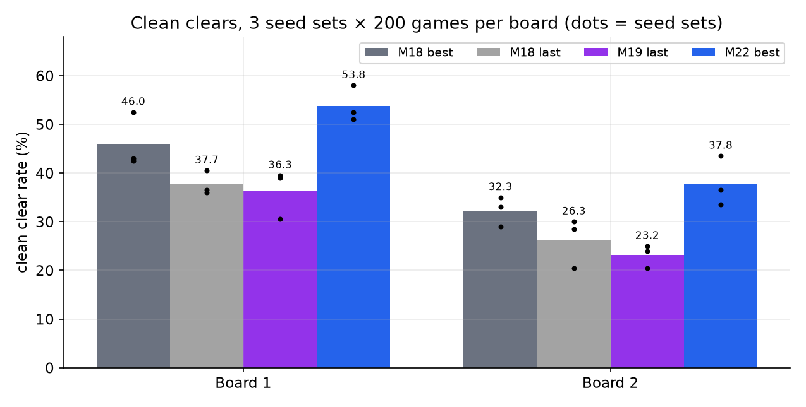

# mspacman-swa: clearing Ms. Pac-Man boards from pixels

[](https://tharunchougoni.github.io/mspacman-swa/)
[](LICENSE)


This is a pixel-only reinforcement-learning agent that **clears whole boards** of Ms. Pac-Man (ALE `MsPacman-v5`, sticky actions 0.25). It isn't trying to farm ghosts for score. The policy is a 7.99M-parameter **sliding-window attention (SWA)** network over 84×84 grayscale frames. It was distilled from a RAM-based Hybrid Reward Architecture planner, then fine-tuned with PPO.

**Full technical report (charts, timeline, negative results): https://tharunchougoni.github.io/mspacman-swa/**

<p align="center"></p>

## Results

| Model | Input | Eval | Board-1 clear | Board-1 clean* | Board-2 clean* |
|---|---|---|---|---|---|
| M5 HRA teacher | RAM | 300 held-out games | 79.7% ± 2.3 | – | – |
| M6 BC + DAgger student | pixels | 300 held-out games | 6.0% | – | – |
| M9 PPO | pixels | 300 held-out games | **83.7% ± 2.1** | – | – |
| M11 multi-board PPO | pixels | 100 games | 90% (1.40 boards/game) | – | – |
| M18 survival reward (start) | pixels | 3 seed sets × 200 games/board | 92.5% | 46.0% | 32.3% |
| **M22 separate value net** | pixels | 3 seed sets × 200 games/board | **97.7%** | **53.8%** | **37.8%** |

\*Clean = board cleared without losing a life.



## How it works

1. **M0: verify the RAM.** Decode positions, lives, the true 150-dot bitmap, frightened flags and the level byte, then build a clear detector (`msclear/ram.py`, `msclear/clear.py`).
2. **M1–M5: a RAM teacher that actually clears.** It uses a maze graph from observed transitions, per-target GVF tables, and an HRA aggregator with ghost, endgame and escape heads (`msclear/maze.py`, `msclear/hra.py`).
3. **M6: distil to pixels.** The SWA student learns by set cross-entropy on 1.6M teacher transitions plus DAgger (`msclear/swa_net.py`, `scripts/m6_*.py`).
4. **M7–M11: PPO fine-tuning.** A KL leash keeps it near the student, with endgame and multi-board start-state pools and an exact KV-cache ALiBi network for fast acting (`msclear/m10_net.py`, `scripts/m9_ppo.py`, `scripts/m11_ppo.py`).
5. **M18–M22: clean clears.** Rewards are −50 per death, +50 for a clean clear and a speed bonus. M22 gives the value function **its own network**, which stopped the fine-tune drift seen in M18 s2 and M19–M21 (`scripts/m18_ppo.py`, `SEPV=1`).

```
frames (4×84×84) ─► CNN ─► token_t ─┐
          tokens t−7 … t (KV cache) ─┴► causal SWA attention (2 layers, d=512, 8 heads, ALiBi)
                                       ├► policy head  π(a|·)
  M22: separate copy of the net ──────► value head    V(·)   (training only)
```

## Setup

```bash
git clone https://github.com/TharunChougoni/mspacman-swa && cd mspacman-swa
uv venv --python 3.11 .venv            # or python3.11 -m venv .venv
uv pip install --python .venv/bin/python -r requirements.txt
.venv/bin/python -m pytest -q
```

## Train and evaluate

Checkpoints and run outputs live in `runs/`, which git ignores (about 50 GB locally), so start from your own runs or ask for the weights. Each milestone has a launcher in `scripts/`:

```bash
# RAM teacher
WORKERS=16 N_DEC=300000 .venv/bin/python scripts/m1_graph.py          # maze graph + GVFs -> runs/m1/
WORKERS=16 N=100 .venv/bin/python scripts/m3_eval.py                  # HRA eval
WORKERS=16 .venv/bin/python scripts/m5_ablation.py                    # endgame/escape ablation
# pixel student and PPO
scripts/m6_run.sh        # demos -> BC -> DAgger
scripts/m9_run.sh        # PPO from the distilled student
scripts/m11_run.sh       # multi-board PPO
scripts/m22_run.sh       # clean-clear PPO with a separate value network (needs runs/m18_s1/)
# evaluation (fp32, held-out seeds)
CKPT=runs/m9run/best.pt SEED0=50000 N=300 OUT=runs/m9/eval.json .venv/bin/python scripts/m9_fasteval.py   # board-1 clear rate
CKPT=runs/m11/best.pt OUTDIR=runs/multiboard_m11 .venv/bin/python scripts/m10_multiboard_eval.py         # boards cleared per game
REP=3 .venv/bin/python scripts/multiseed_eval.py out.json runs/m22/best.pt        # clean clears, 3 seed sets
```

`kaggle/` holds the runner used for the 12-hour Kaggle sessions (resume from the previous session's output). TensorBoard: `.venv/bin/python scripts/tb_simple.py`.

## Repository map

| Path | What |
|---|---|
| `msclear/` | library: RAM map, env wrappers, clear detector, maze graph and HRA teacher, SWA networks, fast evaluators, PPO envs per milestone |
| `scripts/` | one trainer/eval/launcher per milestone (`m0_*` … `m22_run.sh`), DAgger and search-teacher tools, TensorBoard export |
| `tests/` | pytest: RAM map, clear detector, pixel env, SWA/KV-cache parity, fast eval |
| `configs/` | tuned HRA config |
| `results/` | compact eval extracts behind the report charts (evals per run, confirmation evals, multi-seed evals) |
| `runs/` | small tracked logs and metrics (the rest is gitignored) |
| `docs/` | GitHub Pages site (`index.html`, `assets/`) and `docs/notes/` (design plan, ablations, diagnoses) |
| `tools/report/make_charts.py` | rebuilds `docs/assets/*.png` from `results/` |
| `kaggle/` | Kaggle session runner |
| `legacy/`, `seeds/` | helpers kept from the earlier pixel-only project and its Go-Explore states |

## Background

The project grew out of two months of pixel-only attempts (Rainbow, behaviour cloning, return-conditioned DAgger, Go-Explore, LLM players). None of them ever cleared a board, because none of their teachers had. The restart put a clearing RAM teacher first. The report's [Origins section](https://tharunchougoni.github.io/mspacman-swa/#origins) tells that story.

## License

MIT, see [LICENSE](LICENSE).
